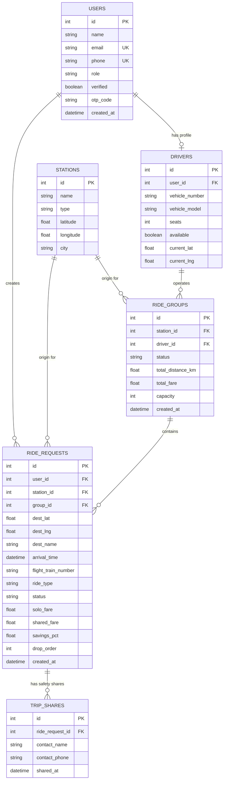

 🚖 ArriveShare

> **Smart, Fair & Safe Ride-Pooling for Airport and Railway Station Arrivals**

ArriveShare is an end-to-end intelligent ride-pooling platform designed specifically for passengers arriving at high-density transportation hubs (airports and railway stations). Instead of hundreds of travelers taking individual, expensive cabs along overlapping corridors, ArriveShare groups passengers arriving within tight time windows, computes optimal multi-stop routes, fairly distributes fares based on distance traveled, and assigns dedicated drivers with real-time status tracking.

---

## 📑 Table of Contents

- [The Problem & The Solution](#-the-problem--the-solution)
- [Key Features](#-key-features)
- [System Architecture](#-system-architecture)
- [Algorithms & Mathematics](#-algorithms--mathematics)
  - [1. Haversine Distance Formulation](#1-haversine-distance-formulation)
  - [2. Detour Compatibility Scoring](#2-detour-compatibility-scoring)
  - [3. Route Sequencing (Greedy Nearest Neighbor)](#3-route-sequencing-greedy-nearest-neighbor)
  - [4. Proportional Fare Splitting Model](#4-proportional-fare-splitting-model)
- [Technology Stack](#-technology-stack)
- [Repository Structure](#-repository-structure)
- [Installation & Setup](#-installation--setup)
  - [Prerequisites](#prerequisites)
  - [Backend Setup (FastAPI)](#backend-setup-fastapi)
  - [Frontend Setup (React + Vite)](#frontend-setup-react--vite)
- [Configuration (.env)](#-configuration-env)
- [API Reference](#-api-reference)
  - [Authentication](#authentication-apiauth)
  - [Stations](#stations-apistations)
  - [Rides](#rides-apirides)
  - [Matching Engine](#matching-apimatches)
  - [Ride Groups](#ride-groups-apigroups)
  - [Driver Operations](#driver-operations-apidriver)
- [Database Schema](#-database-schema)
- [Pre-Seeded Scenarios & Testing](#-pre-seeded-scenarios--testing)
  - [Seeded Test Scenarios](#seeded-test-scenarios)
  - [Running Unit Tests](#running-unit-tests)
- [Frontend User Flows & UI Walkthrough](#-frontend-user-flows--ui-walkthrough)
- [Production & Extensibility Roadmap](#-production--extensibility-roadmap)

---

## 🎯 The Problem & The Solution

| The Challenge | ArriveShare Solution |
| :--- | :--- |
| **High Individual Fares:** Airport and railway taxis levy high base fares and airport surcharges for solo journeys. | **Up to 40%–60% Savings:** Single base fare charged across the cab and distributed proportionally so everyone saves. |
| **Congestion & Carbon Footprint:** Dozens of solo travelers take identical highway corridors simultaneously. | **Maximized Vehicle Utilization:** Consolidates up to 4 passengers into a single vehicle going in the same direction. |
| **Safety Concerns in Ride Shares:** Lack of clarity about who is sharing the vehicle and missing emergency mechanisms. | **Verified Profiles & Emergency Sharing:** Verified first-name-only badges and 1-click SMS/phone trip sharing with emergency contacts. |
| **Unfair Splitting:** Flat 50/50 splits penalize passengers dropped off early along the highway. | **Proportional Weight Splitting:** Fare paid is strictly proportional to solo travel distance. |

---

## ✨ Key Features

- 📍 **Hub-Based Origin Selection:** Pre-configured with major arrival hubs in Bangalore (Kempegowda International Airport BLR, HAL Airport, Bangalore City Railway Station, Yeshwanthpur Railway Station).
- 🧠 **Dynamic Detour Matching Engine:** Filters arrivals by time window (`±20 min`), computes corridor detours, verifies individual passenger detour tolerances (`≤ 5 km`), and respects vehicle seating capacity (`4 passengers`).
- 🗺️ **Multi-Stop Route Optimization:** Orders drop-offs greedily to minimize total vehicle travel distance, backed by OSRM (Open Source Routing Machine) with automatic Haversine fallback.
- 💰 **Mathematical Fair-Share Pricing:** Single base fare split with per-kilometer charges calculated per rider based on relative distance traveled.
- 🔒 **Privacy & Safety First:** Anonymized co-traveler identities (first name + verified badge), drop-off sequencing preview, and emergency trip link sharing.


---

## 🏗️ System Architecture

```
                       ┌──────────────────────────────────────────┐
                       │          React 19 + Vite Client          │
                       │   (Tailwind CSS v4 + React Leaflet)      │
                       └────────────────────┬─────────────────────┘
                                            │ HTTP / JSON
                                            │ JWT Bearer Auth
                                            ▼
                       ┌──────────────────────────────────────────┐
                       │       FastAPI Application Layer          │
                       │               (Port 8000)                │
                       └──────┬─────────────┬─────────────┬───────┘
                              │             │             │
              ┌───────────────┘             │             └──────────────┐
              ▼                             ▼                            ▼
  ┌────────────────────────┐  ┌────────────────────────┐  ┌────────────────────────┐
  │   Matching Engine      │  │  Fare Splitting Engine │  │ Routing / Distance Svc │
  │ • Time Window Filter   │  │ • Solo Fare Formula    │  │ • Haversine Great Circle│
  │ • Pair Detour Scorer   │  │ • Group Route Fare     │  │ • OSRM Road Distance   │
  │ • Group Capacity Check │  │ • Proportional Weight  │  │ • Nearest-Neighbor TSP │
  └───────────┬────────────┘  └─────────────┬──────────┘  └───────────┬────────────┘
              │                             │                         │
              └──────────────────────┬──────┴─────────────────────────┘
                                     ▼
                       ┌───────────────────────────┐
                       │    SQLAlchemy 2.0 ORM     │
                       └─────────────┬─────────────┘
                                     ▼
                       ┌───────────────────────────┐
                       │   SQLite Database (MVP)   │
                       │ (PostgreSQL Production Ready)
                       └───────────────────────────┘
```

---

## 🧮 Algorithms & Mathematics

### 1. Haversine Distance Formulation
Used for high-speed $O(1)$ pairwise distance filtering without exhausting external routing API limits.

$$\Delta \text{lat} = \text{lat}_2 - \text{lat}_1, \quad \Delta \text{lon} = \text{lon}_2 - \text{lon}_1$$

$$a = \sin^2\left(\frac{\Delta \text{lat}}{2}\right) + \cos(\text{lat}_1) \cdot \cos(\text{lat}_2) \cdot \sin^2\left(\frac{\Delta \text{lon}}{2}\right)$$

$$c = 2 \cdot \arcsin\left(\sqrt{a}\right)$$

$$d = R \cdot c \quad \text{where } R = 6371 \text{ km}$$

---

### 2. Detour Compatibility Scoring
To determine if Passenger $B$ can be added to an existing trip to Passenger $A$ from Station $S$:

$$\text{Detour}(A, B) = \min\Big(\text{dist}(S, A) + \text{dist}(A, B),\; \text{dist}(S, B) + \text{dist}(A, B)\Big) - \max\Big(\text{dist}(S, A),\; \text{dist}(S, B)\Big)$$

- If $\text{Detour}(A, B) \le \text{DETOUR\_THRESHOLD\_KM}$ (default `3.0 km`), the pair is eligible.
- When expanding to groups of 3 or 4, the engine recalculates cumulative travel distance for each passenger and verifies:

$$\text{EffectiveDistance}_i - \text{SoloDistance}_i \le \text{MAX\_DETOUR\_KM} \quad (\text{default } 5.0\text{ km}) \quad \forall i$$

---

### 3. Route Sequencing (Greedy Nearest Neighbor)
Given station origin $S$ and destination set $\{D_1, D_2, \dots, D_k\}$ ($k \le 4$):
1. Start at current waypoint $W_0 = S$.
2. In each iteration, select unvisited destination $D^* = \arg\min_{D \in \text{Unvisited}} \text{dist}(W_{\text{curr}}, D)$.
3. Assign sequential order index $1, 2, \dots, k$ and advance $W_{\text{curr}} \leftarrow D^*$.
4. Total group distance:

$$D_{\text{total}} = \sum_{j=0}^{k-1} \text{dist}(W_j, W_{j+1})$$

---

### 4. Proportional Fare Splitting Model
- **Solo Fare:**

$$\text{Fare}_{\text{solo}}(i) = \text{BASE\_FARE} + \left(\text{dist}(S, D_i) \times \text{RATE\_PER\_KM}\right)$$

- **Group Route Fare:** (Base fare is charged **only once** for the vehicle):

$$\text{Fare}_{\text{group}} = \text{BASE\_FARE} + \left(D_{\text{total}} \times \text{RATE\_PER\_KM}\right)$$

- **Passenger Weight & Share:**

$$w_i = \frac{\text{dist}(S, D_i)}{\sum_{j=1}^{k} \text{dist}(S, D_j)}, \qquad \text{Fare}_{\text{shared}}(i) = w_i \times \text{Fare}_{\text{group}}$$

- **Passenger Savings:**

$$\text{Savings } \% = \left(1 - \frac{\text{Fare}_{\text{shared}}(i)}{\text{Fare}_{\text{solo}}(i)}\right) \times 100$$

#### Example Calculation (3 Passengers from Kempegowda Airport)
*(Base Fare = ₹50, Rate = ₹12/km, Optimized Group Route = 25.0 km $\rightarrow$ Group Fare = ₹350)*

| Passenger | Destination | Solo Dist | Solo Fare | Weight ($w_i$) | Shared Fare | Net Savings |
| :--- | :--- | :--- | :--- | :--- | :--- | :--- |
| **Alice** | Indiranagar | 15.0 km | ₹230 | $15 / 53 = 0.283$ | **₹99** | **57.0%** |
| **Bob** | Koramangala | 18.0 km | ₹266 | $18 / 53 = 0.340$ | **₹119** | **55.3%** |
| **Charlie** | HSR Layout | 20.0 km | ₹290 | $20 / 53 = 0.377$ | **₹132** | **54.5%** |
| **Total** | | **53.0 km** | **₹786** | **1.000** | **₹350** | **₹436 saved** |

---

## 💻 Technology Stack

### Backend
- **Language / Runtime:** Python 3.10+
- **Web Framework:** [FastAPI](https://fastapi.tiangolo.com/) (Async, OpenAPI, Pydantic validation)
- **ASGI Server:** [Uvicorn](https://www.uvicorn.org/)
- **Database ORM:** [SQLAlchemy 2.0](https://www.sqlalchemy.org/)
- **Authentication:** [python-jose](https://github.com/mpdavis/python-jose) (JWT HS256) + Passlib/Multipart
- **HTTP Client:** [HTTPX](https://www.python-httpx.org/) (Async requests to OSRM)
- **Configuration:** [Pydantic-Settings](https://docs.pydantic.dev/latest/concepts/pydantic_settings/)
- **Testing:** [Pytest](https://docs.pytest.org/)

### Frontend
- **Framework:** [React 19](https://react.dev/)
- **Build Tool:** [Vite 6](https://vitejs.dev/)
- **Routing:** [React Router v7](https://reactrouter.com/)
- **Styling:** [Tailwind CSS v4](https://tailwindcss.com/) (`@tailwindcss/vite`)
- **Maps:** [Leaflet](https://leafletjs.com/) + [React-Leaflet v5](https://react-leaflet.js.org/) (CartoDB Dark TileLayer)
- **Typography:** Inter (via Google Fonts)

---

## 📁 Repository Structure

```
c:\prject 3 main\
├── README.md                          # Project Documentation
└── arriveshare/
    ├── backend/
    │   ├── .env                       # Environment configuration
    │   ├── arriveshare.db             # Local SQLite database
    │   ├── requirements.txt           # Python dependencies
    │   ├── app/
    │   │   ├── __init__.py            # Application package
    │   │   ├── config.py              # Pydantic Settings & env parameters
    │   │   ├── database.py            # Engine, SessionLocal, and get_db dependency
    │   │   ├── models.py              # SQLAlchemy models (User, Station, RideRequest, etc.)
    │   │   ├── schemas.py             # Pydantic request/response schemas
    │   │   ├── auth.py                # JWT creation, OTP verification, auth dependencies
    │   │   ├── seed.py                # Seed data: Bangalore stations, users, drivers, rides
    │   │   ├── main.py                # FastAPI entry point, lifespan hook, CORS
    │   │   ├── routes/
    │   │   │   ├── __init__.py
    │   │   │   ├── auth.py            # /api/auth endpoints (register, send/verify OTP, me)
    │   │   │   ├── stations.py        # /api/stations endpoints
    │   │   │   ├── rides.py           # /api/rides CRUD, confirm, share-trip
    │   │   │   ├── matches.py         # /api/matches matching & rematch endpoints
    │   │   │   ├── groups.py          # /api/groups details & ordered route points
    │   │   │   └── driver.py          # /api/driver profile, assignments, status lifecycle
    │   │   └── services/
    │   │       ├── __init__.py
    │   │       ├── routing.py         # Haversine, calculate_detour, optimize_drop_order, OSRM
    │   │       ├── fare.py            # calculate_solo_fare, calculate_group_fare, split_fare
    │   │       └── matching.py        # find_candidates, score_candidate, match_ride
    │   └── tests/
    │       ├── __init__.py
    │       └── test_matching.py       # 10 unit tests covering routing, fares, and scenarios A-D
    └── frontend/
        ├── index.html                 # App shell with Google Fonts & favicon
        ├── package.json               # Node.js dependencies and build scripts
        ├── vite.config.js             # Vite config with React, Tailwind, and /api proxy
        ├── tsconfig.json              # TypeScript / JSX configuration
        └── src/
            ├── main.jsx               # React DOM entry point
            ├── App.jsx                # Router, AuthProvider, ProtectedRoute definitions
            ├── index.css              # Tailwind CSS v4, custom theme variables, animations
            ├── context/
            │   └── AuthContext.jsx    # React Context for auth state and quick-login helpers
            ├── services/
            │   └── api.js             # Centralized fetch client for backend endpoints
            └── pages/
                ├── LoginPage.jsx       # Login, Register, OTP entry, Quick Demo selectors
                ├── HomePage.jsx        # Dashboard: active rides, station grid, user info
                ├── RideRequestPage.jsx # Map destination picker, station chooser, solo/share
                ├── MatchingPage.jsx    # Radar animation, match preview, fare savings, accept/decline
                ├── TripPage.jsx        # Active trip progress tracker, live map, emergency share
                └── DriverDashboard.jsx # Driver assignments, stops checklist, earnings, lifecycle
```

---

## 🚀 Installation & Setup

### Prerequisites
- **Python:** 3.10 or higher
- **Node.js:** 18.0 or higher (`npm` included)
- **Git**

---

### Backend Setup (FastAPI)

1. Open PowerShell or a terminal and navigate to the backend directory:
   ```powershell
   cd "c:\prject 3 main\arriveshare\backend"
   ```

2. (Optional but recommended) Create and activate a Python virtual environment:
   ```powershell
   python -m venv venv
   .\venv\Scripts\Activate.ps1
   ```

3. Install required Python packages:
   ```powershell
   pip install -r requirements.txt
   ```

4. Verify or create `.env` file in `backend/` (pre-configured with sensible defaults):
   ```env
   DATABASE_URL=sqlite:///./arriveshare.db
   SECRET_KEY=arriveshare-dev-secret-key-change-in-production
   ALGORITHM=HS256
   ACCESS_TOKEN_EXPIRE_MINUTES=60
   BASE_FARE=50
   RATE_PER_KM=12
   TIME_WINDOW_MINUTES=20
   DETOUR_THRESHOLD_KM=3
   MAX_DETOUR_KM=5
   CAB_CAPACITY=4
   OSRM_BASE_URL=https://router.project-osrm.org
   ```

5. Launch the backend server:
   ```powershell
   uvicorn app.main:app --reload --port 8000
   ```
   > 💡 **Auto-Seeding:** On startup, FastAPI's `lifespan` handler automatically initializes the SQLite schema and runs `seed_all()` to populate the stations, 30 passengers, 5 drivers, and test ride requests.

6. Verify the backend is operational:
   - Health check: `http://localhost:8000/api/health`
   - Interactive Swagger API Docs: `http://localhost:8000/docs`

---

### Frontend Setup (React + Vite)

1. In a separate terminal, navigate to the frontend directory:
   ```powershell
   cd "c:\prject 3 main\arriveshare\frontend"
   ```

2. Install Node dependencies:
   ```powershell
   npm install
   ```

3. Start the Vite development server:
   ```powershell
   npm run dev
   ```

4. Open your browser and navigate to:
   ```
   http://localhost:5173
   ```
   *(Requests to `/api` are automatically proxied to `http://localhost:8000` via `vite.config.js`)*

---

## ⚙️ Configuration (.env)

| Variable | Type | Default | Description |
| :--- | :--- | :--- | :--- |
| `DATABASE_URL` | String | `sqlite:///./arriveshare.db` | Database connection string. Swap to `postgresql://...` for production. |
| `SECRET_KEY` | String | `arriveshare-dev-secret-key...` | Cryptographic secret for signing JWT tokens. |
| `ALGORITHM` | String | `HS256` | JWT signature algorithm. |
| `ACCESS_TOKEN_EXPIRE_MINUTES` | Integer | `60` | JWT expiration duration in minutes. |
| `BASE_FARE` | Float | `50.0` | Initial flat base charge (INR) applied once per vehicle. |
| `RATE_PER_KM` | Float | `12.0` | Variable travel charge per kilometer (INR). |
| `TIME_WINDOW_MINUTES` | Integer | `20` | Maximum arrival time difference between candidates to consider a match. |
| `DETOUR_THRESHOLD_KM` | Float | `3.0` | Maximum additional distance to justify combining two destinations. |
| `MAX_DETOUR_KM` | Float | `5.0` | Hard upper limit on detour added to any single passenger's solo route. |
| `CAB_CAPACITY` | Integer | `4` | Maximum passenger seats per vehicle. |
| `OSRM_BASE_URL` | String | `https://router.project-osrm.org` | Open Source Routing Machine endpoint for driving distance matrices. |

---

## 📡 API Reference

All requests requiring authentication expect the HTTP header:
`Authorization: Bearer <token>`

### Authentication (`/api/auth`)
- `POST /api/auth/register` — Register a new user (`name`, `email`, `phone`, `role`).
- `POST /api/auth/send-otp` — Request login OTP (`{"email": "..."}`). *(In dev mode, OTP is always `1234`)*.
- `POST /api/auth/verify-otp` — Verify OTP and receive JWT access token.
- `GET /api/auth/me` — Retrieve profile of the currently logged-in user.

### Stations (`/api/stations`)
- `GET /api/stations` — List all arrival hubs (airports and railway stations).
- `GET /api/stations/{station_id}` — Get details for a specific station.

### Rides (`/api/rides`)
- `POST /api/rides` — Submit a ride request (`station_id`, `dest_lat`, `dest_lng`, `dest_name`, `arrival_time`, `flight_train_number`, `ride_type`).
- `GET /api/rides/my` — List all ride requests submitted by the logged-in user.
- `GET /api/rides/{ride_id}` — Get complete details for a specific ride.
- `POST /api/rides/{ride_id}/confirm` — Confirm and accept a matched or booked ride.
- `PATCH /api/rides/{ride_id}/status` — Update ride status (`pending`, `matched`, `confirmed`, `on_trip`, `completed`, `cancelled`).
- `POST /api/rides/{ride_id}/share-trip` — Record emergency trip sharing with contact (`contact_name`, `contact_phone`).

### Matching (`/api/matches`)
- `POST /api/matches/find/{ride_id}` — Run the matching engine on a pending shared ride request. Returns matched group, co-travelers, drop-off sequence, and savings percentage.
- `POST /api/matches/decline/{ride_id}` — Decline the current match. Dissolves or recalculates the remaining group and puts the rider back into the candidate pool.

### Ride Groups (`/api/groups`)
- `GET /api/groups/{group_id}` — Retrieve full group information, passenger roster, driver details, and group totals.
- `GET /api/groups/{group_id}/route` — Retrieve ordered waypoints (pickup station + sequential drop-offs) formatted for map rendering.

### Driver Operations (`/api/driver`)
- `GET /api/driver/profile` — Retrieve logged-in driver's profile and vehicle details.
- `GET /api/driver/assignments` — List all ride groups assigned to this driver.
- `GET /api/driver/assignments/{group_id}` — Get specific trip details, passenger names, stops checklist, and total earnings.
- `PATCH /api/driver/assignments/{group_id}/status` — Progress trip status (`forming` $\rightarrow$ `confirmed` $\rightarrow$ `on_trip` $\rightarrow$ `completed`).

---

## 🗄️ Database Schema

The database consists of 6 interconnected tables:



---

## 🧪 Pre-Seeded Scenarios & Testing

### Seeded Test Scenarios

The backend seed script (`app/seed.py`) establishes real-world edge cases for demonstration:

1. **Scenario A (IDs 1–3): 3 Passengers, Identical Destination**
   - Origin: Kempegowda International Airport (BLR)
   - Destination: Koramangala
   - Arrivals: Within 10 minutes of each other.
   - Result: Formed into 1 cab, maximum fare reduction (~50%+ savings each).
2. **Scenario B (IDs 4–5): 2 Passengers, Route Corridor Overlap**
   - Origin: BLR Airport
   - Destinations: Indiranagar & Marathahalli (both along the Eastern corridor).
   - Result: Matched together with nearest drop ordered first.
3. **Scenario C (ID 6): 1 Solo Passenger, No Matching Corridor**
   - Origin: HAL Airport $\rightarrow$ Electronic City (no other passengers in window).
   - Result: Engine returns `404 Not Found`; UI smoothly falls back to a solo private ride.
4. **Scenario D (IDs 7–11): 5 Passengers for a 4-Seat Cab**
   - Origin: Bangalore City Railway Station $\rightarrow$ Jayanagar / JP Nagar / Banashankari.
   - Result: First 4 passengers grouped up to `CAB_CAPACITY = 4`. The 5th passenger overflows into a separate group or solo fallback.

---

### Running Unit Tests

A comprehensive test suite is provided in `backend/tests/test_matching.py`.

To run the unit tests directly:

```powershell
cd "c:\prject 3 main\arriveshare\backend"
python tests/test_matching.py
```

Or using `pytest`:

```powershell
pytest -v tests/test_matching.py
```

#### Test Suite Output
```text
============================================================
  ArriveShare -- Unit Tests
============================================================

[TEST] Haversine Distance
  ✓ BLR → Koramangala = 30.6 km
  ✓ Same point = 0.0 km
  [PASS]

[TEST] Detour: Same Destination
  ✓ Same destination detour = 0.0 km
  [PASS]

[TEST] Detour: Nearby Destinations
  ✓ Koramangala ↔ HSR Layout detour = 1.7 km
  [PASS]

[TEST] Route Optimization
  ✓ Drop order: Indiranagar → Koramangala → Marathahalli
  ✓ Total distance: 39.0 km
  [PASS]

[TEST] Solo Fare Calculation
  ✓ Solo fare for 20 km = ₹290.0
  [PASS]

[TEST] Proportional Fare Split
  ✓ Passenger 1: solo ₹417.31 → shared ₹128.34 (save 69.2%)
  ✓ Passenger 2: solo ₹364.6 → shared ₹109.92 (save 69.9%)
  ✓ Passenger 3: solo ₹369.8 → shared ₹111.74 (save 69.8%)
  [PASS]

[TEST] Scenario A: 3 Same Destination → 1 Cab
  ✓ Group #1 with 3 travelers
  ✓ Solo ₹417.31 → Shared ₹139.1 (save 66.7%)
  ✓ Route: 30.61 km
  [PASS]

[TEST] Scenario B: Route Overlap → Matched
  > Stop #1: Koramangala
  > Stop #2: HSR Layout
  > Savings: 46.5%
  [PASS]

[TEST] Scenario C: No Match → Solo
  ✓ No match found. Solo fare: ₹189.54
  [PASS]

[TEST] Scenario D: 5 Passengers → Capacity Split
  ✓ Group 1: 4 passengers (max 4)
  ✓ Remaining pending: 1 passenger(s)
  ✓ Remaining passenger offered solo ride (₹127.44)
  [PASS]

============================================================
  Results: 10 passed, 0 failed, 10 total
============================================================
```

---

## 📱 Frontend User Flows & UI Walkthrough

### 1. Authentication & Demo Mode (`/login`)
- Log in with email and OTP (`1234` dev mock).
- Registration tab for new passengers.
- **Quick Demo Login:** One-click shortcuts for `Passenger 1`, `Passenger 2`, `Passenger 3`, and `Driver View`.

### 2. Passenger Home Dashboard (`/`)
- Personalized welcome banner.
- Grid of supported transit stations (Airports & Railway Terminals).
- Roster of user's past and active rides with status badges and savings tags.
- Direct link to `+ Book a Ride`.

### 3. Ride Booking & Destination Picker (`/ride/new`)
- Select arrival station.
- Interactive Leaflet dark-mode map: click anywhere in the city or pick from Bangalore neighborhood pills (*Koramangala, Indiranagar, Whitefield, Electronic City, etc.*).
- Input flight or train arrival number (e.g., `6E-2451`, `12657 Exp`).
- Toggle between **Share & Save** and **Book Solo**.

### 4. Radar Matching Screen (`/ride/:rideId/matching`)
- Animated pulsing radar visualizing nearby traveler discovery.
- Match results card displaying:
  - Total percentage saved (e.g., *"You save 54%!"*).
  - Side-by-side Solo vs. Shared fare comparison.
  - Anonymized co-traveler list (*First name, verification badge, destination, drop order*).
  - Sequenced drop-off route timeline with total kilometers.
- Interactive **Accept & Ride Together** or **Decline & Find Another Match**.

### 5. Live Trip Tracker & Safety (`/ride/:rideId`)
- Multi-step status progression bar:
  $$\text{Waiting for Match} \longrightarrow \text{Matched} \longrightarrow \text{Confirmed} \longrightarrow \text{On Trip} \longrightarrow \text{Completed}$$
- Dynamic Leaflet route preview showing the pickup hub, current user's drop marker, and co-traveler stops connected with polyline vectors.
- Assigned driver and vehicle details.
- **Trip Sharing (Safety Feature):** Modal allowing passengers to enter emergency contact name and phone number.
- Fast-forward simulator button (`⏩ Simulate Next Step`) to step through trip stages during live demos.

### 6. Driver Dashboard (`/driver`)
- Vehicle card showing vehicle model, license plate number, seating capacity, and real-time availability toggle.
- Metrics overview: Total trips executed, cumulative earnings in ₹ INR, and passengers served.
- Group assignments list with interactive waypoint route checklist.
- Controls to progress trip states: `Confirm Pickup` $\rightarrow$ `Start Trip` $\rightarrow$ `Complete Trip`.

---

## 🛣️ Production & Extensibility Roadmap

- [ ] **Real-Time WebSockets:** Replace polling with bi-directional WebSocket events for instant driver dispatch notifications and real-time cab GPS tracking.
- [ ] **Payment Gateway Integration:** Incorporate Razorpay/Stripe with escrow holding until all drop-offs are verified.
- [ ] **Flight & Train Live Tracking APIs:** Automatically adjust arrival time windows based on real flight/train delay APIs (FlightAware / IRCTC).
- [ ] **PostgreSQL + PostGIS:** Migrate database to PostgreSQL with PostGIS spatial indices for geospatial bounding-box queries at high scale.
- [ ] **Turn-by-Turn Navigation:** Mobile driver application packaging via React Native / Capacitor with Google Maps / Mapbox turn-by-turn routing.

---

<div align="center">
  <sub>Built with ❤️ for smarter, cleaner, and cheaper airport & station travel.</sub>
</div>
