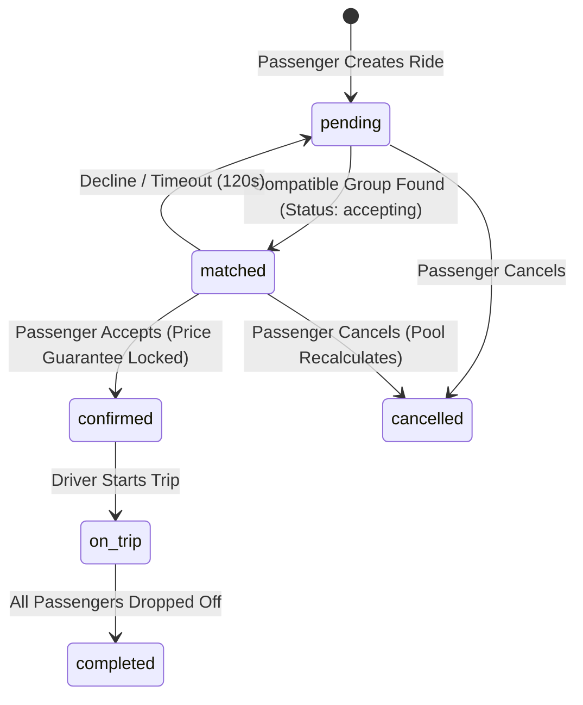

# 🚖 ArriveShare
> **Smart, Fair & Safe Ride-Pooling for Airport and Railway Station Arrivals**


ArriveShare is an intelligent, full-stack ride-pooling platform engineered specifically to solve the high-friction, high-cost bottleneck of transportation hub arrivals. By consolidating travelers arriving at airports and railway stations within narrow time windows and heading along shared transit corridors, ArriveShare dramatically cuts passenger commute expenses, enhances driver earnings, ensures passenger safety and fairness, and mitigates urban highway congestion.


---

## 📑 Table of Contents

- [The Problem Space & Deep Context](#-the-problem-space--deep-context)
  - [1. Context: The Transit Hub Bottleneck](#1-context-the-transit-hub-bottleneck)
  - [2. Detailed Breakdown of Core Problems](#2-detailed-breakdown-of-core-problems)
  - [3. Why Existing Ride-Hailing Platforms Fail at Hubs](#3-why-existing-ride-hailing-platforms-fail-at-hubs)
  - [4. The ArriveShare Solution Matrix](#4-the-arriveshare-solution-matrix)
- [Key Features](#-key-features)
- [System Architecture](#-system-architecture)
- [Algorithms & Mathematical Formulations](#-algorithms--mathematical-formulations)
  - [1. Great-Circle Distance (Haversine Formula)](#1-great-circle-distance-haversine-formula)
  - [2. Dual Detour Compatibility (Percentage & Distance Caps)](#2-dual-detour-compatibility-percentage--distance-caps)
  - [3. Multi-Stop Route Optimization (Exact Permutation TSP Solver)](#3-multi-stop-route-optimization-exact-permutation-tsp-solver)
  - [4. Proportional Fair-Share Pricing & Price Guarantee](#4-proportional-fair-share-pricing--price-guarantee)
- [Technology Stack](#-technology-stack)
- [Repository Structure](#-repository-structure)
- [Installation & Setup](#-installation--setup)
  - [Prerequisites](#prerequisites)
  - [Backend Setup (FastAPI)](#backend-setup-fastapi)
  - [Frontend Setup (React + Vite)](#frontend-setup-react--vite)
- [Configuration (.env)](#-configuration-env)
- [Authentication & Live Email Delivery](#-authentication--live-email-delivery)
  - [1. Zero-Friction Passwordless Onboarding](#1-zero-friction-passwordless-onboarding)
  - [2. Gmail SMTP Integration (Live Emails)](#2-gmail-smtp-integration-live-emails)
  - [3. Development Mode Fallback](#3-development-mode-fallback)
- [API Reference](#-api-reference)
  - [Authentication (`/api/auth`)](#authentication-apiauth)
  - [Stations (`/api/stations`)](#stations-apistations)
  - [Rides (`/api/rides`)](#rides-apirides)
  - [Matching Engine (`/api/matches`)](#matching-engine-apimatches)
  - [Ride Groups (`/api/groups`)](#ride-groups-apigroups)
  - [Driver Operations (`/api/driver`)](#driver-operations-apidriver)
- [Database Schema & State Machine](#-database-schema--state-machine)
- [Testing & Verification](#-testing--verification)
- [Frontend User Flows & UI Walkthrough](#-frontend-user-flows--ui-walkthrough)

---

## 🔍 The Problem Space & Deep Context

### 1. Context: The Transit Hub Bottleneck
Modern international airports and major railway terminals are typically situated far from city business centers and residential clusters. For example, **Kempegowda International Airport (BLR)** is located 35 to 45 km north of central and southern Bangalore (*Koramangala, Indiranagar, HSR Layout, Electronic City*). 

Every day, tens of thousands of travelers disembark from flights and long-distance trains, pass through luggage retrieval, and stream into designated taxi curbsides. Despite heading toward identical neighborhoods along the exact same high-speed expressways, **the default behavior is single-occupancy taxi booking**. This creates acute economic, infrastructural, and environmental crises.

---

### 2. Detailed Breakdown of Core Problems

#### 🔴 Problem 1: The Suburban Hub Distance & Price Shock ("The Airport Tax")
- **Solo Fare Burden:** Solo travelers face baseline cab charges ranging from ₹800 to ₹1,800+ per trip, exacerbated by toll-booth surcharges, airport parking access fees, and peak-hour surge pricing.
- **Underutilized Seat Capacity:** Standard 4-seater sedans and compact SUVs transport a single passenger plus one or two bags, wasting 75% of vehicle passenger capacity while the lone traveler absorbs 100% of the operational and toll expenses.

#### 🔴 Problem 2: The "Arrival Wave" Inefficiency (Temporal Clustering)
- **Batched Arrivals:** Flights and express trains arrive in dense waves (e.g., 8–12 flights landing within a 30-minute block). 
- **Parallel Dispatch:** Hundreds of passengers exit terminal gates simultaneously heading in the exact same direction along primary arterial corridors. Instead of coordinated vehicle sharing, hundreds of individual cabs are dispatched in parallel, duplicating identical route segments along the highway.

#### 🔴 Problem 3: The Flaws & Fallacies of Naive Fare Splitting
- **Unfair 50/50 Splits:** When informal carpools or legacy pooling services split fares equally across riders, passengers dropped off early (e.g., Hebbal at 25 km) effectively subsidize riders traveling to terminal boundaries (e.g., Electronic City at 55 km).
- **Subsidizing Detours:** Riders refuse to carpool if an arbitrary detour adds 10–15 km to their commute while offering negligible fare discounts. A mathematically verifiable, transparent pricing model is required to convince skeptical commuters.

#### 🔴 Problem 4: Trust, Privacy & Personal Safety Vulnerabilities
- **Safety Anxieties Late at Night:** Transit hub arrivals frequently occur between 11:00 PM and 4:00 AM. Boarding an unvetted shared vehicle with strangers introduces justifiable safety and harassment anxieties.
- **Privacy Overexposure:** Displaying full passenger names, phone numbers, or private contact details compromises privacy. Passengers need transparent identity verification without exposing sensitive personally identifiable information (PII).
- **Missing Emergency Safeguards:** When traveling late with shared parties, passengers lack rapid, single-click mechanisms to share live route waypoints, vehicle registration numbers, and co-rider profiles with family or trusted contacts.

#### 🔴 Problem 5: Driver Idling & Deadheading Bottlenecks
- **Staging Lot Idling:** Cab drivers often queue for 45 to 90 minutes in designated airport staging holding areas waiting for an assigned solo fare.
- **Disputed Multi-Stop Logistics:** Drivers resist multi-passenger rides if route sequences are messy, passenger pickup points are scattered, or fare distributions lead to payment friction and disputes.
- **Fixed Earning Ceiling:** A driver carrying one passenger earns only standard solo tariff, whereas carrying a pooled group on an optimized corridor yields higher gross earnings per vehicle trip while each individual passenger pays significantly less.

#### 🔴 Problem 6: Urban Gridlock & Carbon Footprint
- **Corridor Congestion:** Having hundreds of single-occupant cabs funnel into single highway corridors chokes city entry arteries and airport terminal access lanes.
- **Carbon Emissions ($CO_2$):** Consolidating 3 to 4 solo trips into a single shared vehicle immediately cuts corridor emissions by **50% to 66% per passenger-kilometer**.

---

### 3. Why Existing Ride-Hailing Platforms Fail at Hubs

| Platform Limitation | Traditional On-Demand Apps (Uber / Ola / Lyft) | ArriveShare Purpose-Built Architecture |
| :--- | :--- | :--- |
| **Origin Symmetry** | Designed for arbitrary $(x, y)$ origin-to-destination pickups scattered across a city. Picking up riders at different street corners creates massive pickup delays. | **Fixed Hub Origin:** 100% of grouped riders start at the exact same station/airport terminal exit. Zero pickup detour. |
| **Detour Management** | In legacy pooling, cabs zigzag into narrow residential alleys for intermediate pickups, causing unpredictable travel times and frustration. | **Corridor Detour Ceiling:** Strict dual mathematical thresholds ($\le 30\%$ and $\le 6.0\text{ km}$ maximum individual detour). Drops are strictly ordered along the forward path. |
| **Luggage & Capacity** | Assumes casual city commutes without luggage; pooling fails when multiple riders have oversized suitcases. | **Capacity Cap:** Groups strictly limited to 3–4 passengers in standard vehicles to guarantee trunk space for transit hub luggage. |
| **Pricing Transparency** | Dynamic black-box surge algorithms charge arbitrary rates to each pool rider. | **Deterministic Formula:** Base fare charged once per cab; distance rate split proportionally to each rider's solo distance with **Price Guarantees**. |
| **Safety Integration** | Emergency buttons call public hotlines but lack proactive trip broadcasting tailored for shared carpools. | **Proactive Trip Sharing:** 1-click trusted contact broadcasting with verified first-name-only badges, driver details, and stop orders. |

---

### 4. The ArriveShare Solution Matrix

```
       [ Transit Hub: Airport / Railway Station ]
                          │
          ┌───────────────┴───────────────┐
          ▼                               ▼
    Passenger A (Indiranagar)      Passenger B (Koramangala)
    Arrival: 10:15 PM              Arrival: 10:25 PM
    Solo Quote: ₹230               Solo Quote: ₹266
          │                               │
          └───────────────┬───────────────┘
                          │
              [ Spatial-Temporal Matching ]
              • Bounding box pre-filter O(1)
              • Window: ±10 to 20 mins tolerance
              • Detour: <= 30% & <= 6 km
                          │
                          ▼
            [ Exact Permutation TSP Solver ]
            Route: Hub -> Indiranagar -> Koramangala
            Distance: 21.4 km (vs 33.0 km combined solo)
                          │
                          ▼
             [ Proportional Fare Split ]
             Base Fare charged ONCE: ₹50
             Shared Total: ₹306.80
             Passenger A: ₹125.80 (45% savings)
             Passenger B: ₹181.00 (32% savings)
             Price Guarantee: Locked on acceptance
                          │
                          ▼
             [ 2-Min Countdown Match Radar ]
             Auto Driver Assignment & Live Broadcast
```

---

## ⚡ Key Features

- **Hub-Centric Shared Origin:** 100% focused on Airport and Railway arrivals (*BLR Airport, HAL Airport, Bangalore City Station, Yeshwanthpur*).
- **Zero-Friction Authentication:** Instant passwordless sign-in for **any** email address. Auto-provisions traveler profiles on the fly.
- **Live Gmail SMTP Delivery:** Outbound verification dispatch powered by Gmail SMTP with sleek HTML email branding, plus local dev fallback.
- **Dual Detour Thresholds:** Matches are strictly filtered to ensure no rider's route deviates by more than $30\%$ of their solo route or $6.0\text{ km}$ in absolute detour.
- **Exact Permutation TSP Solver ($N \le 4$):** Evaluates all route permutations to minimize driving distance and carbon emissions.
- **Price Guarantee Protection:** Once a match is accepted, a rider's quote is permanently capped. If subsequent route shifts occur, platform subsidies absorb the difference.
- **2-Minute Acceptance Window:** Interactive radar screen with real-time countdown timer before final group dispatch.
- **Flexible Wait Tolerances:** Riders select arrival tolerances ($\pm 10$, $\pm 15$, or $\pm 20$ minutes).
- **Proportional Fair-Share Pricing:** Base fare is charged once per cab; distance charges are split proportionally to solo distances.
- **Background Matching Daemon:** Scans pending pools every 20 seconds to dynamically pair late-arriving travelers.
- **Driver Dashboard with Turn-by-Turn Waypoints:** Live interface for cab drivers showing total earnings, vehicle status, and sequence cards.
- **Safety First Architecture:** Emergency SOS triggers, trusted contact broadcast links, and privacy-preserving first-name passenger profiles.

---

## 📐 Algorithms & Mathematical Formulations

### 1. Great-Circle Distance (Haversine Formula)

Given coordinates $(\phi_1, \lambda_1)$ and $(\phi_2, \lambda_2)$ in radians:

$$\Delta\phi = \phi_2 - \phi_1, \quad \Delta\lambda = \lambda_2 - \lambda_1$$

$$a = \sin^2\left(\frac{\Delta\phi}{2}\right) + \cos(\phi_1)\cos(\phi_2)\sin^2\left(\frac{\Delta\lambda}{2}\right)$$

$$c = 2 \cdot \arcsin\left(\sqrt{a}\right)$$

$$d = R \cdot c \quad \text{where } R = 6371.0\text{ km}$$

---

### 2. Dual Detour Compatibility (Percentage & Distance Caps)

To evaluate if candidate $B$ can join existing group $G$ originating at hub $S$:

1. **Relative Detour Constraint:**
   $$\frac{\text{Detour}(i)}{\text{SoloDistance}(i)} \le \text{MAX\_DETOUR\_PCT} \quad (\text{default } 30\%)$$

2. **Absolute Distance Cap:**
   $$\text{Detour}(i) \le \text{MAX\_DETOUR\_KM} \quad (\text{default } 6.0\text{ km})$$

Where:
$$\text{Detour}(i) = \text{CumulativeDropDistance}(i) - \text{SoloDistance}(S, D_i)$$

---

### 3. Multi-Stop Route Optimization (Exact Permutation TSP Solver)

Given origin $S$ and up to $k \le 4$ passenger destinations $\{D_1, \dots, D_k\}$:
1. Generate all $k!$ ordering permutations (for $k=4$, $4! = 24$ permutations, evaluating in $<0.1\text{ ms}$).
2. For each permutation $P = (D_{\pi(1)}, \dots, D_{\pi(k)})$, compute the total road distance:
   $$D(P) = \text{dist}(S, D_{\pi(1)}) + \sum_{j=1}^{k-1} \text{dist}(D_{\pi(j)}, D_{\pi(j+1)})$$
3. Select permutation $P^* = \arg\min_P D(P)$ satisfying monotonic forward corridor progress.

---

### 4. Proportional Fair-Share Pricing & Price Guarantee

#### Step 1: Solo Baseline
$$\text{Fare}_{\text{solo}}(i) = \text{BASE\_FARE} + \left(\text{dist}(S, D_i) \times \text{RATE\_PER\_KM}\right)$$

#### Step 2: Group Total (Base Fare charged once per cab)
$$\text{Fare}_{\text{group}} = \text{BASE\_FARE} + \left(D_{\text{total}} \times \text{RATE\_PER\_KM}\right)$$

#### Step 3: Proportional Distance Weight Allocation
$$w_i = \frac{\text{dist}(S, D_i)}{\sum_{j=1}^{k} \text{dist}(S, D_j)}, \quad \text{Fare}_{\text{shared}}(i) = \text{round}(w_i \times \text{Fare}_{\text{group}},\; 2)$$

#### Step 4: Price Guarantee Locking
$$\text{FinalFare}(i) = \min\left(\text{Fare}_{\text{shared}}(i),\; \text{AcceptedFare}(i)\right)$$

If an added rider or route shift causes $\text{Fare}_{\text{shared}}(i) > \text{AcceptedFare}(i)$, the platform subsidizes the difference:
$$\text{PlatformSubsidy} = \sum_i \max(0, \text{Fare}_{\text{shared}}(i) - \text{AcceptedFare}(i))$$

---

## 💻 Technology Stack

### Backend
- **Language / Runtime:** Python 3.10+
- **Framework:** [FastAPI](https://fastapi.tiangolo.com/) (Async endpoints, Pydantic v2 schemas)
- **Database:** SQLite with **WAL Mode** enabled + 5000ms busy timeout + idempotent migration runner
- **ORM:** [SQLAlchemy 2.0](https://www.sqlalchemy.org/)
- **Authentication:** [python-jose](https://github.com/mpdavis/python-jose) (JWT HS256)
- **Email Service:** `smtplib` + `email.mime` (Gmail STARTTLS on port 587) with HTML branding
- **Routing Engine:** Cached [OSRM Project](https://project-osrm.org/) client with 3.0s timeout and Haversine fallback
- **Testing:** [Pytest](https://docs.pytest.org/) (21 unit & integration tests)

### Frontend
- **Framework:** [React 19](https://react.dev/) + [Vite 6](https://vitejs.dev/)
- **Routing:** [React Router v7](https://reactrouter.com/)
- **Styling:** [Tailwind CSS v4](https://tailwindcss.com/) + Glassmorphic dark theme tokens
- **Maps:** [Leaflet 1.9.4](https://leafletjs.com/) + [React-Leaflet](https://react-leaflet.js.org/) (Custom markers & CartoDB tiles)
- **Icons & Font:** Lucide icons & Google Fonts (Inter)

---

## 📁 Repository Structure

```
c:\prject 3 main\
├── README.md                          # Comprehensive Documentation
├── IMPLEMENTATION_PLAN.md             # 8-Milestone Engineering Roadmap
├── AUDIT.md                           # System Audit & Architecture Blueprint
└── arriveshare/
    ├── backend/
    │   ├── .env                       # Environment variables (DB, JWT, SMTP, OSRM)
    │   ├── arriveshare.db             # Local SQLite database (WAL mode)
    │   ├── requirements.txt           # Python dependencies
    │   ├── app/
    │   │   ├── config.py              # Pydantic Settings with .env loading
    │   │   ├── database.py            # SQLite engine, WAL configuration & schema migrations
    │   │   ├── models.py              # SQLAlchemy ORM models (User, Station, RideRequest, Driver, etc.)
    │   │   ├── schemas.py             # Pydantic request & response validation schemas
    │   │   ├── auth.py                # Passwordless auth, OTP delivery, JWT verification
    │   │   ├── main.py                # FastAPI lifespan, background worker, router setup
    │   │   ├── seed.py                # Hubs, passengers, and driver seeders
    │   │   ├── routes/                # REST API route controllers
    │   │   │   ├── auth.py            # /api/auth endpoints
    │   │   │   ├── stations.py        # /api/stations endpoints
    │   │   │   ├── rides.py           # /api/rides CRUD & lifecycle endpoints
    │   │   │   ├── matches.py         # /api/matches matching radar endpoints
    │   │   │   ├── groups.py          # /api/groups pooling details
    │   │   │   └── driver.py          # /api/driver assignments & trip progression
    │   │   └── services/
    │   │       ├── state_machine.py   # State machine transitions with optimistic concurrency
    │   │       ├── routing.py         # Exact permutation solver, dual detour filter, OSRM
    │   │       ├── fare.py            # Canonical fare formulas, proportional split, guarantees
    │   │       ├── matching.py        # Matching engine & background scanner worker
    │   │       └── email.py           # SMTP HTML verification email dispatcher
    │   └── tests/
    │       ├── test_matching.py       # Unit tests for routing, detours, and fare splits
    │       └── test_api_endpoints.py  # End-to-end integration tests
    └── frontend/
        ├── package.json               # Frontend dependencies
        ├── vite.config.js             # Vite build & /api proxy setup
        ├── src/
        │   ├── App.jsx                # Route declarations & ProtectedRoute wrappers
        │   ├── index.css              # Design tokens, gradients, glassmorphism
        │   ├── context/
        │   │   └── AuthContext.jsx    # Auth state, local token sync, demo login helpers
        │   ├── services/
        │   │   └── api.js             # REST API fetch client
        │   └── pages/
        │       ├── LoginPage.jsx      # Passwordless login, real email OTP, quick demo buttons
        │       ├── HomePage.jsx       # Rider dashboard, station picker, trip history
        │       ├── RideRequestPage.jsx# Interactive map booking, wait window tolerance selector
        │       ├── MatchingPage.jsx   # Radar radar screen, 2-min countdown, price guarantee badge
        │       ├── TripPage.jsx       # Real-time multi-stop route tracker & emergency share
        │       └── DriverDashboard.jsx# Driver vehicle stats, availability toggle, route stops
```

---

## 🚀 Installation & Setup

### Prerequisites
- **Python:** 3.10+
- **Node.js:** 18.0+ (`npm` included)

---

### Backend Setup (FastAPI)

1. Open PowerShell and navigate to the backend directory:
   ```powershell
   cd "c:\prject 3 main\arriveshare\backend"
   ```

2. (Optional) Create and activate a Python virtual environment:
   ```powershell
   python -m venv venv
   .\venv\Scripts\Activate.ps1
   ```

3. Install dependencies:
   ```powershell
   pip install -r requirements.txt
   ```

4. Configure your `.env` file (see [Configuration](#-configuration-env) below).

5. Start the backend server:
   ```powershell
   python -m uvicorn app.main:app --host 127.0.0.1 --port 8000 --reload
   ```

6. Verify the server:
   - Health check: `http://localhost:8000/api/health`
   - Interactive Swagger API documentation: `http://localhost:8000/docs`

---

### Frontend Setup (React + Vite)

1. In a new PowerShell terminal, navigate to the frontend directory:
   ```powershell
   cd "c:\prject 3 main\arriveshare\frontend"
   ```

2. Install Node packages:
   ```powershell
   npm install
   ```

3. Start the Vite development server:
   ```powershell
   npm run dev
   ```

4. Open your browser to:
   ```
   http://localhost:5173
   ```

---

## ⚙️ Configuration (.env)

Edit `arriveshare/backend/.env`:

```env
# Database & Security
DATABASE_URL=sqlite:///./arriveshare.db
SECRET_KEY=arriveshare-dev-secret-key-change-in-production
ALGORITHM=HS256
ACCESS_TOKEN_EXPIRE_MINUTES=60

# Pricing Parameters (INR)
BASE_FARE=50
RATE_PER_KM=12

# Matching & Detour Engine
TIME_WINDOW_MINUTES=20
DEFAULT_MATCH_WINDOW_MINUTES=20
DETOUR_THRESHOLD_KM=3.0
MAX_DETOUR_PCT=0.30
MAX_DETOUR_KM=6.0
CAB_CAPACITY=4
ACCEPT_WINDOW_SECONDS=120
BACKGROUND_MATCH_INTERVAL_SECONDS=20
DEMO_MODE=true

# External Routing
OSRM_BASE_URL=https://router.project-osrm.org
OSRM_TIMEOUT_SECONDS=3.0

# Live SMTP Email Configuration (Gmail)
SMTP_ENABLED=true
SMTP_HOST=smtp.gmail.com
SMTP_PORT=587
SMTP_USERNAME=your_gmail@gmail.com
SMTP_PASSWORD=your_16_character_app_password
SMTP_FROM_EMAIL=your_gmail@gmail.com
SMTP_FROM_NAME=ArriveShare
SMTP_USE_TLS=true
```

---

## ✉️ Authentication & Live Email Delivery

### 1. Zero-Friction Passwordless Onboarding
- Travelers simply enter **any email address** on the login page.
- If the account does not exist, ArriveShare **auto-creates a traveler profile** on the fly with a friendly display name. No initial forms or 404 blocks.

### 2. Gmail SMTP Integration (Live Emails)
- Real verification emails are sent using Google's secure SMTP relay.
- Each email includes the 6-digit verification code, an arrival-themed responsive HTML template, security advice, and a 15-minute expiration timer.

### 3. Development Mode Fallback
- If `SMTP_ENABLED=false` or credentials are unset, the system does not crash or stall.
- The verification code is printed directly to the backend terminal console **and** displayed on the screen with an **Auto-fill ✓** button for rapid local testing.

---

## 📡 API Reference

### Authentication (`/api/auth`)
| Method | Endpoint | Description |
| :--- | :--- | :--- |
| `POST` | `/api/auth/send-otp` | Auto-provisions traveler if new and sends 6-digit OTP |
| `POST` | `/api/auth/verify-otp` | Verifies code and returns JWT access token |
| `POST` | `/api/auth/register` | Registers custom traveler profile (name, phone, role) |
| `GET` | `/api/auth/me` | Returns current user's profile |

### Stations (`/api/stations`)
| Method | Endpoint | Description |
| :--- | :--- | :--- |
| `GET` | `/api/stations` | Lists all 4 Bangalore transit hubs |
| `GET` | `/api/stations/{id}` | Retrieves specific station details |

### Rides (`/api/rides`)
| Method | Endpoint | Description |
| :--- | :--- | :--- |
| `POST` | `/api/rides` | Creates ride request & triggers immediate auto-match |
| `GET` | `/api/rides/my` | Lists all ride requests for the authenticated user |
| `GET` | `/api/rides/{id}` | Retrieves ride request status, fare, and group assignment |
| `PATCH`| `/api/rides/{id}` | Modifies destination or wait window tolerance |
| `POST` | `/api/rides/{id}/confirm` | Accepts group and locks in Price Guarantee |
| `POST` | `/api/rides/{id}/cancel` | Safely dissolves/recalculates pool upon cancellation |

### Matching Engine (`/api/matches`)
| Method | Endpoint | Description |
| :--- | :--- | :--- |
| `POST` | `/api/matches/find/{ride_id}` | Scans candidate pools and forms ride groups |
| `GET` | `/api/matches/status/{ride_id}`| Returns status, countdown timer, and savings |
| `POST` | `/api/matches/decline/{ride_id}`| Declines formed group and rejoins matching pool |

### Driver Operations (`/api/driver`)
| Method | Endpoint | Description |
| :--- | :--- | :--- |
| `GET` | `/api/driver/profile` | Driver vehicle info & availability status |
| `POST` | `/api/driver/toggle-availability`| Toggles driver online / offline duty |
| `GET` | `/api/driver/assignments` | Lists assigned groups (`accepting`, `confirmed`, `on_trip`) |
| `GET` | `/api/driver/assignments/{group_id}`| Ordered stops, passenger names, and map route |
| `POST` | `/api/driver/assignments/{group_id}/status`| Advances status: `confirmed` $\to$ `on_trip` $\to$ `completed` |

---

## 🗄️ Database Schema & State Machine



### Table Definitions:
1. **`users`**: Traveler & driver accounts (`email`, `phone`, `role`, `verified`, `otp_code`).
2. **`stations`**: Fixed transit hubs (`name`, `type`, `latitude`, `longitude`, `city`).
3. **`drivers`**: Vehicle details (`vehicle_number`, `vehicle_model`, `seats`, `available`, `current_lat`, `current_lng`).
4. **`ride_requests`**: Passenger bookings (`arrival_time`, `match_window_minutes`, `status`, `solo_fare`, `shared_fare`, `accepted_fare`, `platform_subsidy`, `accept_expires_at`, `version`).
5. **`ride_groups`**: Pooled groups (`station_id`, `driver_id`, `status`, `total_distance_km`, `total_fare`, `platform_subsidy`, `accept_expires_at`, `version`).
6. **`trip_shares`**: Emergency safety sharing records with trusted contacts.

---

🧪 Testing & Verification
ArriveShare includes an automated test suite covering all routing permutations, detour limits, fair splits, and concurrency.

Run tests using Pytest:

bash
cd arriveshare/backend
python -m pytest tests/ -v
Test Coverage Highlights:
test_matching.py:
Distance computation verification (Haversine vs OSRM).
Exact permutation solver correctness ($N \le 4$).
Dual detour threshold compliance ($\le 30%$ and $\le 6.0\text{ km}$).
Proportional fair-share pricing and single base fare check.
Price guarantee persistence under late-joiner additions.
test_api_endpoints.py:
Passwordless authentication flow & token issuance.

---

## 📱 Frontend User Flows & UI Walkthrough

1. **Login Page (`/login`)**:
   - Seamless passwordless login: Enter any email $\to$ Get 6-digit OTP in inbox (or on-screen fallback) $\to$ Enter app.
   - Quick Demo Login buttons for 3 pre-seeded passengers and driver.
2. **Passenger Home (`/`)**:
   - Total money saved and trips counter.
   - Quick-select station chips for Bangalore hubs.
   - Active ride cards and single-click booking.
3. **Ride Request Page (`/ride/new`)**:
   - Interactive Leaflet map with destination pin.
   - Luggage count selector and wait window tolerance buttons ($\pm 10$, $15$, $20$ min).
4. **Matching Radar (`/ride/:id/matching`)**:
   - Animated radar screen scanning for co-travelers along the same corridor.
   - Real-time 2-minute countdown timer with Price Guarantee badge.
   - Transparent cost breakdown showing solo price vs shared split.
5. **Trip Status Page (`/ride/:id`)**:
   - Live multi-stop route polyline.
   - - Driver vehicle and contact card.
   - 1-click **Share Trip with Family** and **Emergency SOS** triggers.
6. **Driver Dashboard (`/driver`)**:
   - Online/Offline availability toggle.
   - Total earnings and completed trips tracker.
   - Assigned group route map with numbered pickup and dropoff stops.
   - Single-click **Accept Ride Group** and trip progression buttons.


---

<p align="center">
  <b>ArriveShare</b> · Smart, Fair & Safe Ride-Pooling for Hub Arrivals
</p>
```
