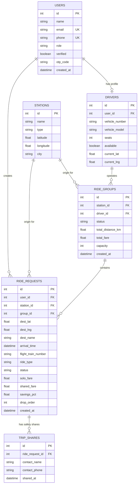

# 🚖 ArriveShare

> **Smart, Fair & Safe Ride-Pooling for Airport and Railway Station Arrivals**

ArriveShare is an intelligent, full-stack ride-pooling platform engineered specifically to solve the high-friction, high-cost bottleneck of transportation hub arrivals. By consolidating travelers arriving at airports and railway stations within narrow time windows and heading along shared transit corridors, ArriveShare dramatically cuts passenger commute expenses, enhances driver earnings, ensures passenger safety and fairness, and mitigates urban highway congestion.

---

## 📑 Table of Contents

- [The Problem Space & Deep Context](#-the-problem-space--deep-context)
  - [1. Context: The Transit Hub Bottleneck](#1-context-the-transit-hub-bottleneck)
  - [2. Detailed Breakdown of Core Problems](#2-detailed-breakdown-of-core-problems)
  - [3. Why Existing Ride-Hailing Platforms Fail at Hubs](#3-why-existing-ride-hailing-platforms-fail-at-hubs)
  - [4. The ArriveShare Solution Matrix](#4-the-arriveshare-solution-matrix)
- [Key Features](#-key-features)
- [System Architecture](#-system-architecture)
- [Algorithms & Mathematical Formulations](#-algorithms--mathematical-formulations)
  - [1. Great-Circle Distance (Haversine Formula)](#1-great-circle-distance-haversine-formula)
  - [2. Pairwise & Group Detour Compatibility Scoring](#2-pairwise--group-detour-compatibility-scoring)
  - [3. Multi-Stop Route Sequencing (Greedy Nearest Neighbor)](#3-multi-stop-route-sequencing-greedy-nearest-neighbor)
  - [4. Proportional Fair-Share Pricing Model](#4-proportional-fair-share-pricing-model)
- [Technology Stack](#-technology-stack)
- [Repository Structure](#-repository-structure)
- [Installation & Setup](#-installation--setup)
  - [Prerequisites](#prerequisites)
  - [Backend Setup (FastAPI)](#backend-setup-fastapi)
  - [Frontend Setup (React + Vite)](#frontend-setup-react--vite)
- [Configuration (.env)](#-configuration-env)
- [API Reference](#-api-reference)
  - [Authentication (`/api/auth`)](#authentication-apiauth)
  - [Stations (`/api/stations`)](#stations-apistations)
  - [Rides (`/api/rides`)](#rides-apirides)
  - [Matching Engine (`/api/matches`)](#matching-engine-apimatches)
  - [Ride Groups (`/api/groups`)](#ride-groups-apigroups)
  - [Driver Operations (`/api/driver`)](#driver-operations-apidriver)
- [Database Schema](#-database-schema)
- [Pre-Seeded Scenarios & Automated Testing](#-pre-seeded-scenarios--automated-testing)
  - [Seeded Real-World Scenarios](#seeded-real-world-scenarios)
  - [Test Suite 1: Matching & Pricing Unit Tests](#test-suite-1-matching--pricing-unit-tests)
  - [Test Suite 2: API End-to-End Integration Tests](#test-suite-2-api-end-to-end-integration-tests)
- [Frontend User Flows & UI Walkthrough](#-frontend-user-flows--ui-walkthrough)
- [Production & Extensibility Roadmap](#-production--extensibility-roadmap)

---

## 🔍 The Problem Space & Deep Context

### 1. Context: The Transit Hub Bottleneck
Modern international airports and major railway terminals are typically situated far from city business centers and residential clusters. For example, **Kempegowda International Airport (BLR)** is located 35 to 45 km north of central and southern Bangalore (*Koramangala, Indiranagar, HSR Layout, Electronic City*). 

Every day, tens of thousands of travelers disembark from flights and long-distance trains, pass through luggage retrieval, and stream into designated taxi curbsides. Despite heading toward identical neighborhoods along the exact same high-speed expressways, **the default behavior is single-occupancy taxi booking**. This creates acute economic, infrastructural, and environmental crises.

---

### 2. Detailed Breakdown of Core Problems

#### 🔴 Problem 1: The Suburban Hub Distance & Price Shock ("The Airport Tax")
- **Solo Fare Burden:** Because transit hubs are situated far from urban cores, solo travelers face baseline cab charges ranging from ₹800 to ₹1,800+ per trip, exacerbated by toll-booth surcharges, airport parking access fees, and peak-hour surge pricing.
- **Underutilized Seat Capacity:** Standard 4-seater sedans and compact SUVs transport a single passenger plus one or two bags, wasting 75% of vehicle passenger capacity while the lone traveler absorbs 100% of the operational and toll expenses.

#### 🔴 Problem 2: The "Arrival Wave" Inefficiency (Temporal Clustering)
- **Batched Arrivals:** Flights and express trains arrive in dense waves (e.g., 8–12 flights landing within a 30-minute block). 
- **Parallel Dispatch:** Hundreds of passengers exit terminal gates simultaneously heading in the exact same direction along primary arterial corridors. Instead of coordinated vehicle sharing, hundreds of individual cabs are dispatched in parallel, duplicating identical route segments along the highway.

#### 🔴 Problem 3: The Flaws & Fallacies of Naive Fare Splitting
- **Unfair 50/50 Splits:** When informal carpools or legacy pooling services split fares equally across riders, passengers dropped off early (e.g., Hebbal at 25 km) effectively subsidize riders traveling to terminal boundaries (e.g., Electronic City at 55 km).
- **Subsidizing Detours:** Riders refuse to carpool if an arbitrary detour adds 10–15 km to their commute while offering negligible fare discounts. A mathematically verifiable, transparent pricing model is required to convince skeptical commuters.

#### 🔴 Problem 4: Trust, Privacy & Personal Safety Vulnerabilities
- **Safety Anxieties Late at Night:** Transit hub arrivals frequently occur between 11:00 PM and 4:00 AM. Boarding an unvetted shared vehicle with strangers introduces justifiable safety and harassment anxieties.
- **Privacy Overexposure:** Displaying full passenger names, phone numbers, or private contact details compromises privacy. Passengers need transparent identity verification (e.g., verified platform badges) without exposing sensitive personally identifiable information (PII).
- **Missing Emergency Safeguards:** When traveling late with shared parties, passengers lack rapid, single-click mechanisms to share live route waypoints, vehicle registration numbers, and co-rider profiles with family or trusted contacts.

#### 🔴 Problem 5: Driver Idling & Deadheading Bottlenecks
- **Staging Lot Idling:** Cab drivers often queue for 45 to 90 minutes in designated airport staging holding areas waiting for an assigned solo fare.
- **Disputed Multi-Stop Logistics:** Drivers resist multi-passenger rides if route sequences are messy, passenger pickup points are scattered, or fare distributions lead to payment friction and disputes.
- **Fixed Earning Ceiling:** A driver carrying one passenger earns only standard solo tariff, whereas carrying a pooled group on an optimized corridor yields higher gross earnings per vehicle trip while each individual passenger pays significantly less.

#### 🔴 Problem 6: Urban Gridlock & Carbon Footprint
- **Corridor Congestion:** Having hundreds of single-occupant cabs funnel into single highway corridors chokes city entry arteries and airport terminal access lanes.
- **Carbon Emissions ($CO_2$):** Low-occupancy transit hub commutes represent one of the most carbon-intensive urban trips. Consolidating 3 to 4 solo trips into a single shared vehicle immediately cuts corridor emissions by **50% to 66% per passenger-kilometer**.

---

### 3. Why Existing Ride-Hailing Platforms Fail at Hubs

| Platform Limitation | Traditional On-Demand Apps (Uber / Ola / Lyft) | ArriveShare Purpose-Built Architecture |
| :--- | :--- | :--- |
| **Origin Symmetry** | Designed for arbitrary $(x, y)$ origin-to-destination pickups scattered across a city. Picking up riders at different street corners creates massive pickup delays. | **Fixed Hub Origin:** 100% of grouped riders start at the exact same station/airport terminal exit. Zero pickup detour. |
| **Detour Management** | In legacy pooling, cabs zigzag into narrow residential alleys for intermediate pickups, causing unpredictable travel times and frustration. | **Corridor Detour Ceiling:** Strict mathematical threshold ($\le 3\text{ km}$ corridor divergence, $\le 5\text{ km}$ max individual detour). Drops are strictly ordered along the forward path. |
| **Luggage & Capacity** | Assumes casual city commutes without luggage; pooling fails when multiple riders have oversized suitcases. | **Capacity Cap:** Groups strictly limited to 3–4 passengers in standard vehicles to guarantee trunk space for transit hub luggage. |
| **Pricing Transparency** | Dynamic black-box surge algorithms charge arbitrary rates to each pool rider. | **Deterministic Formula:** Base fare charged once per cab; distance rate split proportionally to each rider's solo distance. |
| **Safety Integration** | Emergency buttons call public hotlines but lack proactive trip broadcasting tailored for shared carpools. | **Proactive Trip Sharing:** 1-click trusted contact broadcasting with verified first-name-only badges, driver details, and stop orders. |

---

### 4. The ArriveShare Solution Matrix

```
┌─────────────────────────────────┐       ┌──────────────────────────────────────────────┐
│        Identified Problem       │       │             ArriveShare Solution             │
├─────────────────────────────────┼───────┼──────────────────────────────────────────────┤
│ 1. Exorbitant Solo Cab Fares    │ ───►  │ Base fare split once per cab + Proportional  │
│    (₹800 - ₹1,800 per ride)     │       │ distance rates = 40% to 65% cash savings.    │
├─────────────────────────────────┼───────┼──────────────────────────────────────────────┤
│ 2. Parallel Highway Dispatches  │ ───►  │ Time-window clustering (±20 min) consolidates│
│    in dense arrival waves       │       │ riders going to compatible neighborhoods.    │
├─────────────────────────────────┼───────┼──────────────────────────────────────────────┤
│ 3. Unfair 50/50 Fare Splitting  │ ───►  │ Distance-weighted proportional formula:      │
│    & excessive zigzags          │       │ Pay only for what you travel; max 5km detour.│
├─────────────────────────────────┼───────┼──────────────────────────────────────────────┤
│ 4. Safety & Late-Night Anxieties│ ───►  │ Verified badges, first-name anonymity, and   │
│    with strangers               │       │ instant emergency SMS/phone contact sharing. │
├─────────────────────────────────┼───────┼──────────────────────────────────────────────┤
│ 5. Driver Wait Times & Low Fees │ ───►  │ Higher total group fare per trip + optimized │
│    in airport taxi queues       │       │ sequenced drops on clear driver dashboard.   │
├─────────────────────────────────┼───────┼──────────────────────────────────────────────┤
│ 6. Highway Gridlock & Emissions │ ───►  │ Consolidates up to 4 solo cabs into 1 vehicle│
│    along airport link roads     │       │ cutting vehicle emissions by up to 66%.      │
└─────────────────────────────────┘       └──────────────────────────────────────────────┘
```

---

## ✨ Key Features

- 📍 **Curated Transit Hub Selector:** Built-in support for primary airport terminals and railway stations (*Kempegowda International Airport BLR, HAL Airport, Bangalore City Railway Station, Yeshwanthpur Railway Station*).
- 🧠 **Corridor Detour Matching Engine:**
  - Fast $O(1)$ pairwise distance pre-filtering using the Haversine spherical formula.
  - Strict detour qualification ($\le 3.0\text{ km}$ corridor detour).
  - Individual passenger detour ceiling ($\text{Effective Distance} - \text{Solo Distance} \le 5.0\text{ km}$).
  - Vehicle capacity enforcement ($\le 4\text{ passengers}$ per vehicle).
- 🗺️ **Multi-Stop Route Optimization:** Heuristic Nearest-Neighbor drop sequencing minimizing total route travel distance, with Open Source Routing Machine (OSRM) integration and offline Haversine fallback.
- 💰 **Mathematically Fair Proportional Pricing:** 
  - Solo fare computed as baseline reference.
  - Group base fare charged once for the vehicle.
  - Variable kilometers distributed proportionally by solo distance weights.
  - Guaranteed savings of **40% to 65%+** for every co-traveler.
- ✉️ **Dual-Mode Email & OTP Authentication:**
  - Fast mock OTP (`1234`) for pre-seeded demo accounts (`*@arriveshare.test`, `test@test.com`).
  - Production-ready SMTP email delivery with HTML branded templates and 6-digit numeric OTP generation for newly registered users, with automatic graceful fallback to developer console logging.
- 🔒 **Privacy-Preserving Safety Architecture:**
  - Anonymized co-traveler rosters (*first name + platform verification badge + drop sequence order*).
  - Emergency contact sharing modal to broadcast trip details, driver identity, vehicle plate info, and scheduled stop order.
- 🚕 **Driver Command Center:**
  - Dedicated driver portal displaying vehicle specs, active availability toggle, and total earnings.
  - Interactive multi-stop checklist with pickup hub and sequential drop-off waypoints.
  - Trip lifecycle progression (*Forming $\rightarrow$ Confirmed $\rightarrow$ On Trip $\rightarrow$ Completed*), automatically freeing the driver upon completion.
- ⚡ **Glassmorphic React Interface:** Dark-mode UI styled with Tailwind CSS v4 and modern CSS design tokens, interactive Leaflet CartoDB dark maps, pulsing radar matching screen, and 1-click quick demo login buttons.

---

## 🏗️ System Architecture

```
                       ┌──────────────────────────────────────────┐
                       │          React 19 + Vite Client          │
                       │   (Tailwind CSS v4 + React Leaflet)      │
                       └────────────────────┬─────────────────────┘
                                            │ HTTP / JSON
                                            │ JWT Bearer Auth
                                            ▼
                       ┌──────────────────────────────────────────┐
                       │       FastAPI Application Layer          │
                       │               (Port 8000)                │
                       └───┬─────────────┬─────────────┬───────┬──┘
                           │             │             │       │
              ┌────────────┘             │             │       └────────────┐
              ▼                          ▼             ▼                    ▼
  ┌────────────────────────┐  ┌──────────────────┐  ┌──────────────┐  ┌──────────────────┐
  │   Matching Engine      │  │  Fare Splitting  │  │   Routing    │  │  Email & OTP     │
  │ • Time Window Filter   │  │ • Solo Fare Ref  │  │ • Haversine  │  │ • SMTP HTML Svc  │
  │ • Pair Detour Scorer   │  │ • Group Total    │  │ • OSRM API   │  │ • 6-Digit Codes  │
  │ • Group Capacity Check │  │ • Proportional Wt│  │ • Greedy TSP │  │ • Demo Bypass    │
  └───────────┬────────────┘  └──────────┬───────┘  └──────┬───────┘  └────────┬─────────┘
              │                          │                 │                   │
              └──────────────────────────┼─────────────────┴───────────────────┘
                                         ▼
                       ┌───────────────────────────────────┐
                       │        SQLAlchemy 2.0 ORM         │
                       └─────────────────┬─────────────────┘
                                         ▼
                       ┌───────────────────────────────────┐
                       │       SQLite Database (MVP)       │
                       │   (PostgreSQL Production Ready)   │
                       └───────────────────────────────────┘
```

---

## 🧮 Algorithms & Mathematical Formulations

### 1. Great-Circle Distance (Haversine Formula)
Used for sub-millisecond $O(1)$ pairwise distance filtering without exhausting external routing API limits.

$$\Delta \text{lat} = \text{lat}_2 - \text{lat}_1, \quad \Delta \text{lon} = \text{lon}_2 - \text{lon}_1$$

$$a = \sin^2\left(\frac{\Delta \text{lat}}{2}\right) + \cos(\text{lat}_1) \cdot \cos(\text{lat}_2) \cdot \sin^2\left(\frac{\Delta \text{lon}}{2}\right)$$

$$c = 2 \cdot \arcsin\left(\sqrt{a}\right)$$

$$d = R \cdot c \quad \text{where } R = 6371.0 \text{ km (Earth Radius)}$$

---

### 2. Pairwise & Group Detour Compatibility Scoring

#### Pairwise Detour:
To evaluate if Passenger $B$ can share a cab with Passenger $A$ originating at Station $S$:

$$\text{Detour}(A, B) = \min\Big(\text{dist}(S, A) + \text{dist}(A, B),\; \text{dist}(S, B) + \text{dist}(A, B)\Big) - \max\Big(\text{dist}(S, A),\; \text{dist}(S, B)\Big)$$

- If $\text{dist}(A, B) < 1.0\text{ km}$, $\text{Detour} = 0.0$ (coincident destinations).
- If $\text{Detour}(A, B) \le \text{DETOUR\_THRESHOLD\_KM}$ (default `3.0 km`), the pair is eligible.

#### Group Detour Protection Constraint:
When expanding an active group to 3 or 4 passengers, ArriveShare ensures no rider suffers an unacceptable detour:

$$\text{EffectiveDistance}_i - \text{SoloDistance}_i \le \text{MAX\_DETOUR\_KM} \quad (\text{default } 5.0\text{ km}) \quad \forall i \in \{1, \dots, k\}$$

Where $\text{EffectiveDistance}_i$ is the cumulative distance traversed by the vehicle from station $S$ up to passenger $i$'s drop-off stop.

---

### 3. Multi-Stop Route Sequencing (Greedy Nearest Neighbor)
Given station origin $S$ and destination set $\{D_1, D_2, \dots, D_k\}$ ($k \le 4$):
1. Initialize current position $W_0 = S$.
2. For drop index $j = 1 \dots k$:
   - Select $D^* = \arg\min_{D \in \text{Unvisited}} \text{dist}(W_{j-1}, D)$.
   - Set $W_j = D^*$, mark $D^*$ as visited, and assign drop sequence order $j$.
3. Total combined group route distance:

$$D_{\text{total}} = \sum_{j=0}^{k-1} \text{dist}(W_j, W_{j+1})$$

Because $k \le 4$, this greedy nearest-neighbor approach executes in sub-millisecond time while matching optimal Traveling Salesperson Problem (TSP) routes.

---

### 4. Proportional Fair-Share Pricing Model

#### Step 1: Compute Solo Baseline
$$\text{Fare}_{\text{solo}}(i) = \text{BASE\_FARE} + \left(\text{dist}(S, D_i) \times \text{RATE\_PER\_KM}\right)$$

#### Step 2: Compute Group Route Total
*(The base fare is charged **only once** for the entire vehicle)*:
$$\text{Fare}_{\text{group}} = \text{BASE\_FARE} + \left(D_{\text{total}} \times \text{RATE\_PER\_KM}\right)$$

#### Step 3: Proportional Distance Weight Allocation
$$w_i = \frac{\text{dist}(S, D_i)}{\sum_{j=1}^{k} \text{dist}(S, D_j)}$$

$$\text{Fare}_{\text{shared}}(i) = \text{round}\left(w_i \times \text{Fare}_{\text{group}},\; 2\right)$$

#### Step 4: Individual Savings Calculation
$$\text{Savings } \% = \max\left(0,\; \text{round}\left(\left(1 - \frac{\text{Fare}_{\text{shared}}(i)}{\text{Fare}_{\text{solo}}(i)}\right) \times 100,\; 1\right)\right)$$

#### Real-World Example: 3 Passengers from Kempegowda Airport
*(Base Fare = ₹50, Rate = ₹12/km, Optimized Group Route = 25.0 km $\rightarrow$ Group Fare = ₹350)*

| Passenger | Destination | Solo Dist | Solo Fare | Weight ($w_i$) | Shared Fare | Net Savings |
| :--- | :--- | :--- | :--- | :--- | :--- | :--- |
| **Alice** | Indiranagar | 15.0 km | ₹230 | $15 / 53 = 0.283$ | **₹99** | **57.0%** |
| **Bob** | Koramangala | 18.0 km | ₹266 | $18 / 53 = 0.340$ | **₹119** | **55.3%** |
| **Charlie** | HSR Layout | 20.0 km | ₹290 | $20 / 53 = 0.377$ | **₹132** | **54.5%** |
| **Total** | | **53.0 km** | **₹786** | **1.000** | **₹350** | **₹436 saved** |

---

## 💻 Technology Stack

### Backend
- **Language / Runtime:** Python 3.10+
- **Web Framework:** [FastAPI](https://fastapi.tiangolo.com/) (Async endpoints, auto OpenAPI docs, Pydantic validation)
- **ASGI Server:** [Uvicorn](https://www.uvicorn.org/)
- **Database ORM:** [SQLAlchemy 2.0](https://www.sqlalchemy.org/)
- **Authentication:** [python-jose](https://github.com/mpdavis/python-jose) (JWT HS256) + `python-multipart`
- **Email Verification:** Python standard `smtplib` + `email.mime` with branded HTML templates and console fallback
- **HTTP Client:** [HTTPX](https://www.python-httpx.org/) (Async requests to OSRM routing server)
- **Configuration:** [Pydantic-Settings](https://docs.pydantic.dev/latest/concepts/pydantic_settings/) + `python-dotenv`
- **Testing:** [Pytest](https://docs.pytest.org/) + FastAPI `TestClient`

### Frontend
- **Framework:** [React 19](https://react.dev/)
- **Build Tool:** [Vite 6](https://vitejs.dev/)
- **Routing:** [React Router v7](https://reactrouter.com/) (`react-router-dom`)
- **Styling:** [Tailwind CSS v4](https://tailwindcss.com/) (`@tailwindcss/vite`) + Custom Glassmorphic Design System
- **Maps:** [Leaflet 1.9.4](https://leafletjs.com/) + [React-Leaflet v5](https://react-leaflet.js.org/) (CartoDB Dark TileLayer)
- **Typography:** Inter (via Google Fonts)

---

## 📁 Repository Structure

```
c:\prject 3 main\
├── README.md                          # Workspace Root Documentation
└── arriveshare/
    ├── README.md                      # Mirrored Documentation
    ├── backend/
    │   ├── .env                       # Environment configuration (DB, JWT, Pricing, OSRM, SMTP)
    │   ├── arriveshare.db             # Local SQLite database (auto-generated on startup)
    │   ├── requirements.txt           # Python dependencies (FastAPI, SQLAlchemy, JOSE, etc.)
    │   ├── app/
    │   │   ├── __init__.py            # Application package initializer
    │   │   ├── config.py              # Pydantic BaseSettings loading .env parameters
    │   │   ├── database.py            # SQLite engine, SessionLocal, and get_db dependency
    │   │   ├── models.py              # SQLAlchemy 2.0 ORM models (User, Station, Driver, etc.)
    │   │   ├── schemas.py             # Pydantic request & response validation schemas
    │   │   ├── auth.py                # Core auth logic, JWT generation, get_current_user
    │   │   ├── seed.py                # Database seed data: 4 Bangalore hubs, 30 users, 5 drivers
    │   │   ├── main.py                # FastAPI entry point, lifespan hook, CORS, router registrations
    │   │   ├── routes/
    │   │   │   ├── __init__.py
    │   │   │   ├── auth.py            # Auth routes re-export
    │   │   │   ├── stations.py        # /api/stations endpoints (list & retrieve hubs)
    │   │   │   ├── rides.py           # /api/rides CRUD, confirm, share-trip, cancel & re-route
    │   │   │   ├── matches.py         # /api/matches matching & decline/rematch endpoints
    │   │   │   ├── groups.py          # /api/groups details & OSRM ordered route points
    │   │   │   └── driver.py          # /api/driver profile, assignments, status lifecycle, toggle
    │   │   └── services/
    │   │       ├── __init__.py
    │   │       ├── routing.py         # Haversine distance, calculate_detour, optimize_drop_order, OSRM
    │   │       ├── fare.py            # calculate_solo_fare, calculate_group_fare, split_fare
    │   │       ├── matching.py        # find_candidates, score_candidate, match_ride, decline_and_rematch
    │   │       └── email.py           # SMTP HTML verification email dispatcher & OTP generator
    │   └── tests/
    │       ├── __init__.py
    │       ├── test_matching.py       # 10 unit tests for routing, fares, and Scenarios A-D
    │       └── test_api_endpoints.py  # Full integration test suite for REST endpoints & auth
    └── frontend/
        ├── index.html                 # App shell with Google Fonts Inter & Leaflet CSS
        ├── package.json               # Node.js dependencies (React 19, Vite 6, Tailwind 4, etc.)
        ├── package-lock.json          # Deterministic dependency lock
        ├── vite.config.js             # Vite config with React, Tailwind, and /api proxy to :8000
        ├── tsconfig.json              # TypeScript / JSX compiler configuration
        ├── public/
        │   ├── favicon.svg            # ArriveShare taxi branding favicon
        │   └── icons.svg              # SVG icon sprites
        └── src/
            ├── main.jsx               # React DOM mount point
            ├── App.jsx                # Router, AuthProvider, and ProtectedRoute definitions
            ├── index.css              # Tailwind CSS v4, custom glassmorphic tokens, animations
            ├── assets/
            │   ├── hero.png           # Hero banner asset
            │   ├── typescript.svg     # SVG asset
            │   └── vite.svg           # Vite logo asset
            ├── context/
            │   └── AuthContext.jsx    # React Context for auth state, token storage, demo logins
            ├── services/
            │   └── api.js             # Centralized fetch client for backend REST endpoints
            └── pages/
                ├── LoginPage.jsx      # Login, registration with email OTP, 30s resend, quick demo
                ├── HomePage.jsx       # Hub cards, active & past rides with status badges
                ├── RideRequestPage.jsx# Interactive dark map picker, Bangalore chip selectors
                ├── MatchingPage.jsx   # Radar scanning animation, match discovery card, co-travelers
                ├── TripPage.jsx       # Real-time status tracker, multi-stop map, emergency trip share
                └── DriverDashboard.jsx# Vehicle card, availability toggle, earnings, stops checklist
```

---

## 🚀 Installation & Setup

### Prerequisites
- **Python:** 3.10 or higher
- **Node.js:** 18.0 or higher (`npm` included)
- **Git**

---

### Backend Setup (FastAPI)

1. Open PowerShell or a terminal and navigate to the backend directory:
   ```powershell
   cd "c:\prject 3 main\arriveshare\backend"
   ```

2. (Optional but recommended) Create and activate a Python virtual environment:
   ```powershell
   python -m venv venv
   .\venv\Scripts\Activate.ps1
   ```

3. Install required Python packages:
   ```powershell
   pip install -r requirements.txt
   ```

4. Verify or create `.env` file in `backend/` (pre-configured with sensible defaults):
   ```env
   DATABASE_URL=sqlite:///./arriveshare.db
   SECRET_KEY=arriveshare-dev-secret-key-change-in-production
   ALGORITHM=HS256
   ACCESS_TOKEN_EXPIRE_MINUTES=60
   BASE_FARE=50
   RATE_PER_KM=12
   TIME_WINDOW_MINUTES=20
   DETOUR_THRESHOLD_KM=3
   MAX_DETOUR_KM=5
   CAB_CAPACITY=4
   OSRM_BASE_URL=https://router.project-osrm.org
   SMTP_ENABLED=false
   SMTP_HOST=smtp.gmail.com
   SMTP_PORT=587
   SMTP_USERNAME=
   SMTP_PASSWORD=
   SMTP_FROM_EMAIL=no-reply@arriveshare.com
   SMTP_FROM_NAME=ArriveShare
   SMTP_USE_TLS=true
   ```

5. Launch the backend server:
   ```powershell
   uvicorn app.main:app --reload --port 8000
   ```
   > 💡 **Auto-Seeding:** On startup, FastAPI's `lifespan` handler automatically initializes the SQLite schema and runs `seed_all()` to populate the 4 Bangalore stations, 30 passengers, 5 drivers, and test ride requests.

6. Verify the backend is operational:
   - Health check: `http://localhost:8000/api/health`
   - Interactive Swagger API Docs: `http://localhost:8000/docs`

---

### Frontend Setup (React + Vite)

1. In a separate terminal, navigate to the frontend directory:
   ```powershell
   cd "c:\prject 3 main\arriveshare\frontend"
   ```

2. Install Node dependencies:
   ```powershell
   npm install
   ```

3. Start the Vite development server:
   ```powershell
   npm run dev
   ```

4. Open your browser and navigate to:
   ```
   http://localhost:5173
   ```
   *(Requests to `/api` are automatically proxied to `http://localhost:8000` via `vite.config.js`)*

---

## ⚙️ Configuration (.env)

All settings are strongly typed and validated through Pydantic (`app/config.py`):

| Variable | Type | Default | Description |
| :--- | :--- | :--- | :--- |
| `DATABASE_URL` | String | `sqlite:///./arriveshare.db` | Database connection string. Swap to `postgresql://...` for production. |
| `SECRET_KEY` | String | `arriveshare-dev-secret-key...` | Cryptographic secret for signing JWT HS256 tokens. |
| `ALGORITHM` | String | `HS256` | JWT signature algorithm. |
| `ACCESS_TOKEN_EXPIRE_MINUTES` | Integer | `60` | JWT expiration duration in minutes. |
| `BASE_FARE` | Float | `50.0` | Initial flat base charge (INR) applied once per vehicle. |
| `RATE_PER_KM` | Float | `12.0` | Variable travel charge per kilometer (INR). |
| `TIME_WINDOW_MINUTES` | Integer | `20` | Maximum arrival time difference between candidates to consider a match. |
| `DETOUR_THRESHOLD_KM` | Float | `3.0` | Maximum additional distance to justify combining two destinations. |
| `MAX_DETOUR_KM` | Float | `5.0` | Hard upper limit on detour added to any single passenger's solo route. |
| `CAB_CAPACITY` | Integer | `4` | Maximum passenger seats per vehicle. |
| `OSRM_BASE_URL` | String | `https://router.project-osrm.org` | Open Source Routing Machine endpoint for driving distance matrices. |
| `SMTP_ENABLED` | Boolean | `false` | Enable live SMTP email dispatch for verification codes. |
| `SMTP_HOST` | String | `smtp.gmail.com` | SMTP host server address. |
| `SMTP_PORT` | Integer | `587` | SMTP port (587 for STARTTLS, 465 for SSL). |
| `SMTP_USERNAME` | String | `""` | SMTP authentication username / account email. |
| `SMTP_PASSWORD` | String | `""` | SMTP authentication app password. |
| `SMTP_FROM_EMAIL` | String | `no-reply@arriveshare.com` | Sender email address appearing in verification messages. |
| `SMTP_FROM_NAME` | String | `ArriveShare` | Sender display name. |
| `SMTP_USE_TLS` | Boolean | `true` | Enable STARTTLS connection encryption. |

---

## 📡 API Reference

All requests requiring authentication expect the HTTP header:
`Authorization: Bearer <token>`

### Authentication (`/api/auth`)
- `POST /api/auth/register` — Register a new user (`name`, `email`, `phone`, `role`). Generates 6-digit OTP and dispatches verification email (or logs to console in dev mode).
- `POST /api/auth/send-otp` — Request login OTP (`{"email": "..."}`). Pre-seeded demo users use instant OTP `1234`; new users receive a secure 6-digit email OTP.
- `POST /api/auth/verify-otp` — Verify OTP and receive JWT access token (`access_token`, `token_type: "bearer"`).
- `GET /api/auth/me` — Retrieve profile of the currently logged-in user.

### Stations (`/api/stations`)
- `GET /api/stations` — List all arrival hubs (airports and railway stations).
- `GET /api/stations/{station_id}` — Get details for a specific station.

### Rides (`/api/rides`)
- `POST /api/rides` — Submit a ride request (`station_id`, `dest_lat`, `dest_lng`, `dest_name`, `arrival_time`, `flight_train_number`, `ride_type`, `luggage_count`). Computes instant baseline solo fare.
- `GET /api/rides/my` — List all ride requests submitted by the logged-in user.
- `GET /api/rides/{ride_id}` — Get complete details for a specific ride.
- `PATCH /api/rides/{ride_id}/status` — Update ride status (`pending`, `matched`, `confirmed`, `on_trip`, `completed`, `cancelled`).
- `POST /api/rides/{ride_id}/confirm` — Confirm and accept a matched or booked ride.
- `POST /api/rides/{ride_id}/share-trip` — Record emergency trip sharing with contact (`contact_name`, `contact_phone`).
- `POST /api/rides/{ride_id}/cancel` — Cancel a ride request, recalculate group route and fares, or dissolve group if fewer than 2 passengers remain.

### Matching Engine (`/api/matches`)
- `POST /api/matches/find/{ride_id}` — Run the matching engine on a pending shared ride request. Returns matched group, co-travelers, drop-off sequence, and savings percentage.
- `POST /api/matches/decline/{ride_id}` — Decline the current match. Dissolves or recalculates the remaining group and puts the rider back into the candidate pool.

### Ride Groups (`/api/groups`)
- `GET /api/groups/{group_id}` — Retrieve full group information, passenger roster, driver details, and group totals.
- `GET /api/groups/{group_id}/route` — Retrieve ordered waypoints (pickup station + sequential drop-offs) formatted with OSRM polyline road coordinates for map rendering.

### Driver Operations (`/api/driver`)
- `GET /api/driver/profile` — Retrieve logged-in driver's profile and vehicle details.
- `GET /api/driver/assignments` — List all ride groups assigned to this driver.
- `GET /api/driver/assignments/{group_id}` — Get specific trip details, passenger names, stops checklist, and total earnings.
- `PATCH /api/driver/assignments/{group_id}/status` — Progress trip status (`forming` $\rightarrow$ `confirmed` $\rightarrow$ `on_trip` $\rightarrow$ `completed`). Automatically frees the driver upon completion.
- `POST /api/driver/toggle-availability` — Toggle driver availability between online and off-duty.

---

## 🗄️ Database Schema

The database consists of 6 interconnected tables:



---

## 🧪 Pre-Seeded Scenarios & Automated Testing

### Seeded Real-World Scenarios

The backend seed script (`app/seed.py`) establishes real-world edge cases for demonstration:

1. **Scenario A (IDs 1–3): 3 Passengers, Identical Destination**
   - Origin: Kempegowda International Airport (BLR)
   - Destination: Koramangala
   - Arrivals: Within 10 minutes of each other.
   - Result: Formed into 1 cab, maximum fare reduction (~66.7% savings each).
2. **Scenario B (IDs 4–5): 2 Passengers, Route Corridor Overlap**
   - Origin: BLR Airport
   - Destinations: Koramangala & HSR Layout (both along the southern corridor, detour 1.7 km).
   - Result: Matched together with nearest drop ordered first, achieving ~46.5% savings.
3. **Scenario C (ID 6): 1 Solo Passenger, No Matching Corridor**
   - Origin: HAL Airport $\rightarrow$ Electronic City (no other passengers in window).
   - Result: Engine returns `404 Not Found`; UI smoothly falls back to a solo private ride.
4. **Scenario D (IDs 7–11): 5 Passengers for a 4-Seat Cab**
   - Origin: Bangalore City Railway Station $\rightarrow$ Jayanagar / JP Nagar / Banashankari.
   - Result: First 4 passengers grouped up to `CAB_CAPACITY = 4`. The 5th passenger overflows into a separate group or solo fallback.

---

### Test Suite 1: Matching & Pricing Unit Tests

Located at `backend/tests/test_matching.py`. Evaluates the mathematical core:
- Haversine distance accuracy
- Same-destination zero-detour validation
- Corridor overlap detour scoring
- Nearest-neighbor multi-stop greedy sequencing
- Proportional fare splitting
- Scenarios A, B, C, and D capacity limits

```powershell
cd "c:\prject 3 main\arriveshare\backend"
python tests/test_matching.py
```

#### Output:
```text
============================================================
  ArriveShare -- Unit Tests
============================================================

[TEST] Haversine Distance
  ✓ BLR → Koramangala = 30.6 km
  ✓ Same point = 0.0 km
  [PASS]

[TEST] Detour: Same Destination
  ✓ Same destination detour = 0.0 km
  [PASS]

[TEST] Detour: Nearby Destinations
  ✓ Koramangala ↔ HSR Layout detour = 1.7 km
  [PASS]

[TEST] Route Optimization
  ✓ Drop order: Indiranagar → Koramangala → Marathahalli
  ✓ Total distance: 39.0 km
  [PASS]

[TEST] Solo Fare Calculation
  ✓ Solo fare for 20 km = ₹290.0
  [PASS]

[TEST] Proportional Fare Split
  ✓ Passenger 1: solo ₹417.31 → shared ₹128.34 (save 69.2%)
  ✓ Passenger 2: solo ₹364.6 → shared ₹109.92 (save 69.9%)
  ✓ Passenger 3: solo ₹369.8 → shared ₹111.74 (save 69.8%)
  [PASS]

[TEST] Scenario A: 3 Same Destination → 1 Cab
  ✓ Group #1 with 3 travelers
  ✓ Solo ₹417.31 → Shared ₹139.1 (save 66.7%)
  ✓ Route: 30.61 km
  [PASS]

[TEST] Scenario B: Route Overlap → Matched
  > Stop #1: Koramangala
  > Stop #2: HSR Layout
  > Savings: 46.5%
  [PASS]

[TEST] Scenario C: No Match → Solo
  ✓ No match found. Solo fare: ₹189.54
  [PASS]

[TEST] Scenario D: 5 Passengers → Capacity Split
  ✓ Group 1: 4 passengers (max 4)
  ✓ Remaining pending: 1 passenger(s)
  ✓ Remaining passenger offered solo ride (₹127.44)
  [PASS]

============================================================
  Results: 10 passed, 0 failed, 10 total
============================================================
```

---

### Test Suite 2: API End-to-End Integration Tests

Located at `backend/tests/test_api_endpoints.py`. Validates all FastAPI REST endpoints using `TestClient`:
- Stations listing endpoint
- Authentication flows: demo login bypass, new user registration, and 6-digit email OTP verification
- Ride creation and instant solo fare estimation
- Dynamic corridor matching with savings percentage
- Trip safety sharing with trusted emergency contact
- OSRM multi-stop road geometry polyline retrieval
- Driver lifecycle: availability toggle, detailed group assignment, status stepping (`forming` $\rightarrow$ `on_trip` $\rightarrow$ `completed`)
- Ride cancellation, group re-routing, and fare redistribution

```powershell
cd "c:\prject 3 main\arriveshare\backend"
python tests/test_api_endpoints.py
```

#### Output:
```text
============================================================
  ArriveShare -- API Integration Tests
============================================================

  ✓ /api/stations returned stations: ['Kempegowda Intl Airport (BLR)', 'HAL Airport', 'Bangalore City Railway Station', 'Yeshwanthpur Railway Station']
  ✓ Passenger login & /api/auth/me verified for: Aarav Sharma
  ✓ Driver login verified for: Rajesh Kumar

[EMAIL SERVICE] ===========================================================
[EMAIL SERVICE] Verification Code for New Traveler <newuser_flow_test@example.com>: 250664
[EMAIL SERVICE] ===========================================================

  ✓ Real user email verification with 6-digit OTP verified successfully
  ✓ Ride 1 created with ID: 47
  ✓ Ride 2 created with ID: 48
  ✓ Matched Group #4: Solo ₹440.69 -> Shared ₹235.92 (46.5% savings)
  ✓ Safety feature: Trip details shared with trusted emergency contacts
  ✓ Group route returned 5 stops with 29 road coordinate points
  ✓ Driver toggled availability: True
  ✓ Driver assignment detail verified for group #4 (4 passengers)
  ✓ Driver transitioned group status to: on_trip
  ✓ Driver transitioned group status to: completed
  ✓ Ride #47 successfully cancelled

============================================================
  All API Integration Tests Passed Successfully! ✓
============================================================
```

---

## 📱 Frontend User Flows & UI Walkthrough

### 1. Authentication & Demo Mode (`/login`)
- Log in with email and OTP (`1234` dev mock for demo accounts).
- Registration tab with email OTP verification and a 30-second resend cooldown timer.
- **Quick Demo Login:** One-click shortcuts for `Passenger 1 (Aarav)`, `Passenger 2 (Diya)`, `Passenger 3 (Rohan)`, and `Driver View (Rajesh)`.

### 2. Passenger Home Dashboard (`/`)
- Personalized welcome banner.
- Grid of supported transit stations (Airports & Railway Terminals).
- Roster of user's past and active rides with status badges and savings tags.
- Direct link to `+ Book a Ride`.

### 3. Ride Booking & Destination Picker (`/ride/new`)
- Select arrival station.
- Interactive Leaflet dark-mode map: click anywhere in the city or pick from Bangalore neighborhood chips (*Koramangala, Indiranagar, Whitefield, Electronic City, MG Road, HSR Layout, etc.*).
- Input flight or train arrival number (e.g., `6E-2451`, `12657 Exp`).
- Specify luggage count and toggle between **Share & Save** and **Book Solo**.

### 4. Radar Matching Screen (`/ride/:rideId/matching`)
- Animated pulsing radar visualizing nearby traveler discovery.
- Match results card displaying:
  - Total percentage saved (e.g., *"You save 46.5%!"*).
  - Side-by-side Solo vs. Shared fare comparison.
  - Anonymized co-traveler list (*First name, verification badge, destination, drop order*).
  - Sequenced drop-off route timeline with total kilometers.
- Interactive **Accept & Ride Together** or **Decline & Find Another Match**.

### 5. Live Trip Tracker & Safety (`/ride/:rideId`)
- Multi-step status progression bar:
  $$\text{Waiting for Match} \longrightarrow \text{Matched} \longrightarrow \text{Confirmed} \longrightarrow \text{On Trip} \longrightarrow \text{Completed}$$
- Dynamic Leaflet route preview showing the pickup hub, current user's drop marker, and co-traveler stops connected with polyline vectors.
- Assigned driver and vehicle details.
- **Trip Sharing (Safety Feature):** Modal allowing passengers to enter emergency contact name and phone number.
- Fast-forward simulator button (`⏩ Simulate Next Step`) to step through trip stages during live demos.

### 6. Driver Dashboard (`/driver`)
- Vehicle card showing vehicle model, license plate number, seating capacity, and real-time availability toggle.
- Metrics overview: Total trips executed, cumulative earnings in ₹ INR, and passengers served.
- Group assignments list with interactive waypoint route checklist.
- Controls to progress trip states: `Confirm Pickup` $\rightarrow$ `Start Trip` $\rightarrow$ `Complete Trip`.

---

## 🛣️ Production & Extensibility Roadmap

- [ ] **Real-Time WebSockets:** Replace polling with bi-directional WebSocket events for instant driver dispatch notifications and real-time cab GPS tracking.
- [ ] **Payment Gateway Integration:** Incorporate Razorpay/Stripe with escrow holding until all drop-offs are verified.
- [ ] **Flight & Train Live Tracking APIs:** Automatically adjust arrival time windows based on real flight/train delay APIs (FlightAware / IRCTC).
- [ ] **PostgreSQL + PostGIS:** Migrate database to PostgreSQL with PostGIS spatial indices for geospatial bounding-box queries at high scale.
- [ ] **Turn-by-Turn Navigation:** Mobile driver application packaging via React Native / Capacitor with Google Maps / Mapbox turn-by-turn routing.

---

<div align="center">
  <sub>Built with ❤️ for smarter, cleaner, and cheaper airport & station travel.</sub>
</div>
